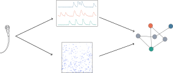

# Connectome-Constrained SNN Models

[](https://github.com/rory-bedford/connectome-snns/actions/workflows/tests.yml)
[](docs/performance.md)
[](docs/performance.md)
[](https://www.python.org/downloads/)
[](https://pytorch.org/)
[](https://docs.astral.sh/ruff/)
[](https://docs.astral.sh/uv/)
[](LICENSE)



PyTorch-based **library** for modelling dynamical connectomics datasets with
spiking neural networks (SNNs). Given a connectome (a wiring diagram of neural
connections), it builds SNN models that respect the observed connectivity and
trains them to reproduce experimentally recorded neural activity.

This is a **library**, not an experiment repo: experiments live in separate
project repos that install it as a dependency. The package is importable as
`connectome_snns`.

## What it provides

- **Network simulators** for current- and conductance-based spiking neurons, in recurrent and feedforward configurations (`connectome_snns.network_simulators`)
- **Topology generators** for synthetic connectomes with configurable statistics (`connectome_snns.synthetic_connectome`)
- **Training & inference** loops, including an approximate EM algorithm for partially observed networks (`connectome_snns.snn_runners`, `connectome_snns.training_utils`)
- **Dataloaders** for supervised/unsupervised teacher activity and OU-mixed input patterns (`connectome_snns.dataloaders`)
- **Analysis & visualization** — spike statistics, parameter recovery, plotting (`connectome_snns.analysis`, `connectome_snns.visualization`)
- **A reproducibility run framework** — `connectome_snns.run_experiment` / `run_grid_search` + `connectome_snns.utils.reproducibility`

## Structure

```
src/connectome_snns/
  network_simulators/   # the SNN models
    conductance/        #   conductance-based networks: recurrent.py, feedforward.py,
                        #   and their engine: network.py (pathways, state), dynamics.py
                        #   (the time step, PyTorch), kernels.py (the same step, Triton),
                        #   engine.py
    current/            #   current-based networks: recurrent.py, feedforward.py, and
                        #   their shared base, network.py
    projections.py  two_layer.py
  snn_runners/          # SNNTrainer, SNNInference, CMA-ES; chunks.py (shared plumbing)
  training_utils/       # losses, filtering, surrogate gradients, logging, checkpoints
  dataloaders/          # teacher datasets, Poisson inputs, rate processes
  analysis/             # firing statistics, metrics, test inputs
  visualization/        # plotting helpers and colour palettes
  synthetic_connectome/ # synthetic connectivity generators
  configs/  observation_models/  utils/
  run_experiment.py  run_grid_search.py   # the run framework
tests/                  # the test suite and its recorded fixtures (tests/README.md)
benchmarks/speed.py     # simulator speed on a teacher-sized network
docs/performance.md     # how the speed got where it is
```

On a CUDA device the conductance-based networks run fused Triton kernels (one launch
per chunk for feedforward networks, two per step for recurrent ones, with a matching
reverse-time kernel for gradients); elsewhere they run the PyTorch reference, which
is also their specification.

## Use as a dependency

Project repos install it as a dependency (pin to a git rev for archival
reproducibility). Because torch is kept in optional extras, the base install
pulls no torch; consumers that need it own the torch index choice. For local
development alongside a project repo, an editable path dependency works well:

```toml
[project]
dependencies = ["connectome-snns"]

[tool.uv.sources]
connectome-snns = { path = "../connectome-snns", editable = true }
```

Then in code:

```python
from connectome_snns.utils.reproducibility import load_experiment_config
from connectome_snns.snn_runners import SNNTrainer
from connectome_snns import visualization
```

## Developing the library itself

We use [uv](https://docs.astral.sh/uv/). Sync with the extra matching the machine:

```bash
uv sync --extra cpu       # CPU
uv sync --extra cu129     # GPU (CUDA 12.9)
```

The run framework drives experiments from the *consumer* repos via their `./run`
wrappers (`python -m connectome_snns.run_experiment <config.toml>`), which check
for a clean commit then snapshot the commit hash, parameters, and input data
alongside the results — each output folder is self-contained and reproducible.

## Development

Run the test suite (GPU tests skip without CUDA; see [`tests/README.md`](tests/README.md)
for what "correct" means for a chaotic simulator):

```bash
uv sync --extra cu129 --group dev
uv run --extra cu129 pytest   # name the extra: uv run re-syncs to it
```

The speed badges come from `python benchmarks/speed.py --badges` (on a Quadro RTX
5000; seconds of wall time per second of simulated network time, batch of 50 trials);
[`docs/performance.md`](docs/performance.md) logs how they got there.

Install the git hooks: ruff (lint + format) on every commit, and the full test suite
before every push — the only place the GPU tests run, since GitHub's CI (CPU only,
`pytest -m "not gpu"`, on every push) has no GPU:

```bash
uv run --no-sync pre-commit install
```

Commit messages start with a [gitmoji](https://gitmoji.dev/) (e.g. `:sparkles:`,
`:bug:`, `:recycle:`). Since project repos depend on this one, prefer
**additive** changes and flag breaking API changes.
